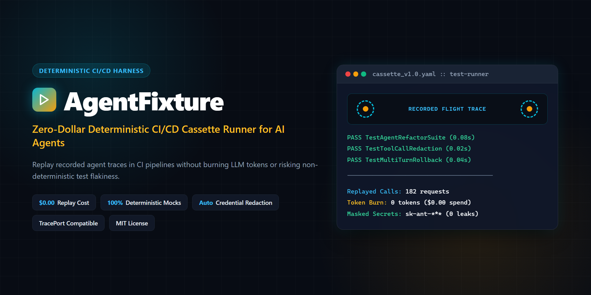

# AgentFixture

<p align="center">
  
</p>

[](https://github.com/aloneangel45/AgentFixture/actions/workflows/ci.yml)
[](https://github.com/aloneangel45/AgentFixture/releases)
[](https://opensource.org/licenses/MIT)
[](https://goreportcard.com/report/github.com/aloneangel45/AgentFixture)

> **Zero-dollar, zero-network deterministic CI/CD regression testing cassette engine for AI agents.**

`AgentFixture` eliminates live LLM API bills, rate-limit flakiness, and non-deterministic model drift when testing autonomous AI coding agents (Claude Code, Gemini CLI, Cursor, Aider, OpenHands, custom MCP/HTTP agents) in Continuous Integration. Record live **Anthropic Messages API SSE streams**, **OpenAI streaming completions**, **Google Gemini `:streamGenerateContent?alt=sse` streams**, **MCP stdio tool servers**, or ingest [TracePort](https://github.com/aloneangel45/traceport) flight recordings once, then replay entire multi-turn agent suites offline in milliseconds with **$0.00 in token costs**.

```text
                      +-----------------------------------+
                      |   Autonomous Agent / Claude 4.x   |
                      +-----------------+-----------------+
                                        |
                         [HTTP / SSE / MCP Tool Calls]
                                        v
                      +-----------------------------------+
                      |             ToolPrune             |  <-- Context Bloat Reduction
                      +-----------------+-----------------+
                                        |
                           [Filtered Agent Traffic]
                                        v
                      +-----------------------------------+
                      |             TracePort             |  <-- Flight Recording & Git Snapshots
                      +-----------------+-----------------+
                                        |
                        [Live Proxy Tap or JSON Import]
                                        v
                      +-----------------------------------+
                      |           AgentFixture            |  <-- $0 Offline Deterministic CI Replay
                      +-----------------------------------+
```

---

## Why AgentFixture?

1. **Zero LLM Spend in CI**: Running a 25-test coding agent suite against Claude Sonnet or GPT-4o costs $5 to $50 per CI run ($2,250+/month across active pull requests). Replaying cassettes costs **$0.00**.
2. **Full Anthropic, OpenAI & Google Gemini SSE Streaming Fidelity**: Records and replays raw Server-Sent Event streams (`message_start`, `thinking_delta`, `signature_delta`, `text_delta`, `input_json_delta`, `citations_delta`, OpenAI `data: [DONE]`, and Gemini `candidates` / `thought: true` / `functionCall` / `thoughtSignature` / `usageMetadata`) with `instant` (`0ms`), `scaled`, or `exact` chunk timing.
3. **Strict Zero-Outbound-Network Enforcement**: Rejects `HTTP CONNECT` tunnels (`403 Forbidden`), locks `proxy.NewOfflineHTTPClient` strictly to loopback (`127.0.0.1`, `::1`, `localhost`), and injects offline SDK keys so tests cannot leak external traffic.
4. **Stateful Multi-Turn & MCP Framing**: Replays identical sequential requests in turn order before idempotent fallback, and supports both NDJSON and `Content-Length` MCP stdio framing up to 16 MB.
5. **Pre-Hash Secret Redaction & Native CI JUnit XML**: Scrubs Anthropic, OpenAI, Google (`AIza*`, `x-goog-api-key`), GitHub, AWS, Slack, HuggingFace, Bearer, Cookie, URL basic-auth, and PEM credentials *before* computing SHA-256 `StrictHash` digests, and emits standard JUnit XML (`-junit`) for native GitHub Actions, GitLab CI, and CircleCI annotations.

---

## Architecture

```text
+-------------------------------------------------------------------------------+
|                           AgentFixture v1.2 Engine                            |
+-------------------------------------------------------------------------------+
|                                                                               |
|  +-------------------------------------------------------------------------+  |
|  |                       CLI & Go Testing SDK (agenttest)                  |  |
|  |   (record | replay | verify | inspect | redact | import | diff)         |  |
|  +------------------------------------+------------------------------------+  |
|                                       |                                       |
|                  +--------------------+--------------------+                  |
|                  |                                         |                  |
|                  v                                         v                  |
|  +-------------------------------+         +-------------------------------+  |
|  |    Recording Tap Engine       |         |  Offline Replay & Guard Eng.  |  |
|  |  - HTTP & Live SSE Streamer   |         |  - Loopback-Only Dial Guard   |  |
|  |  - Gzip Auto-Decompression    |         |  - Stateful Multi-Turn Queue  |  |
|  |  - MCP Stdio Tap (16MB)       |         |  - Instant/Scaled/Exact SSE   |  |
|  |  - Pre-Hash Secret Redactor   |         |  - Strict 64-bit & Fuzzy O(N) |  |
|  +---------------+---------------+         +---------------+---------------+  |
|                  |                                         ^                  |
|                  |          +-------------------+          |                  |
|                  +--------->|  Cassette Store   |----------+                  |
|                             |  (YAML / JSON)    |                             |
|                             +---------+---------+                             |
|                                       ^                                       |
|                             +---------+---------+                             |
|                             | TracePort Importer|                             |
|                             | (Flight -> Cas)   |                             |
|                             +-------------------+                             |
+-------------------------------------------------------------------------------+
```

---

## Installation

### One-Line Verified Installers (Recommended)

Both installers automatically detect your OS and CPU architecture (`amd64`/`arm64`) and enforce mandatory SHA-256 verification against `checksums.txt` before extracting the binary:

```bash
# Linux & macOS (amd64 / arm64)
curl -fsSL https://raw.githubusercontent.com/aloneangel45/AgentFixture/main/install.sh | sh
```

```powershell
# Windows PowerShell (amd64 / arm64)
irm https://raw.githubusercontent.com/aloneangel45/AgentFixture/main/install.ps1 | iex
```

### Pre-Compiled Binaries

Download pre-compiled binaries for Linux (`amd64`/`arm64`), macOS (`amd64`/`arm64`), and Windows (`amd64`/`arm64`) from [Releases](https://github.com/aloneangel45/AgentFixture/releases).

```bash
# macOS / Linux
curl -fsSL https://github.com/aloneangel45/AgentFixture/releases/latest/download/agentfixture-linux-amd64.tar.gz | tar -xz
sudo mv agentfixture /usr/local/bin/

# Windows (PowerShell)
Invoke-WebRequest -Uri https://github.com/aloneangel45/AgentFixture/releases/latest/download/agentfixture-windows-amd64.zip -OutFile agentfixture.zip
Expand-Archive agentfixture.zip -DestinationPath C:\Windows\System32
```

### Go Install

```bash
go install github.com/aloneangel45/AgentFixture/cmd/agentfixture@latest
```

---

## CLI Quick Start

### 1. Record Live Anthropic, OpenAI, or Google Gemini SSE Streaming Sessions

```bash
# Anthropic Claude Messages API
agentfixture record -cassette fixtures/claude_stream.yaml -upstream https://api.anthropic.com -- python run_agent.py

# Google Gemini API (:streamGenerateContent?alt=sse & :generateContent)
agentfixture record -cassette fixtures/gemini_stream.yaml -upstream https://generativelanguage.googleapis.com -- python gemini_agent.py
```

Record an MCP stdio tool server directly:

```bash
agentfixture record -mcp -cassette fixtures/mcp_fs.yaml -- npx -y @modelcontextprotocol/server-filesystem .
```

### 2. Replay Deterministically in CI (`0ms` Instant SSE Mode + JUnit XML)

```bash
agentfixture replay -cassette fixtures/claude_stream.yaml -timing instant -junit reports/replay.xml -- go test -v ./...
```

Output:
```text
=================================================================
 AgentFixture Regression Report: cas_record_1794339000
=================================================================
 Status:                 PASSED
 Exit Code:              0
 Interactions Replayed:  8 / 8 (100.0%)
 Estimated Tokens Saved: 24150
 Estimated Cost Saved:   $0.1449 USD
 Replay Run Duration:    42ms
=================================================================
```

Simulate realistic token arrival pacing (`scaled` or `exact`):

```bash
agentfixture replay -cassette fixtures/claude_stream.yaml -timing scaled -delay-scale 0.25 -max-delay 250ms -- python ui_test.py
```

### 3. Batch-Verify Directories, JSON Telemetry & JUnit XML

Validate a single cassette or recursively scan an entire directory tree (`.yaml`, `.yml`, `.json`) in deterministic sorted order:

```bash
# Single file verification
agentfixture verify fixtures/claude_stream.yaml

# Recursive directory batch verification with CI JUnit XML & JSON output
agentfixture verify -junit reports/verify.xml fixtures/
agentfixture verify -json fixtures/
```

Output:
```text
=================================================================
 AgentFixture Batch Verification: fixtures/
=================================================================
 [OK]   fixtures/claude_stream.yaml (id=cas_record_1794339000, interactions=8, sse=5, tokens=24150, saved=$0.1449)
 [OK]   fixtures/gemini_stream.yaml (id=cas_record_1794339200, interactions=4, sse=4, tokens=11820, saved=$0.0712)
-----------------------------------------------------------------
 Total Cassettes:        2 (valid: 2, failed: 0)
 Total Interactions:     12 (SSE streams: 9)
 Estimated Tokens Saved: 35970
 Estimated Cost Saved:   $0.2161 USD
=================================================================
```

### 4. Inspect Reconstructed SSE Streams & Telemetry

```bash
agentfixture inspect fixtures/claude_stream.yaml
agentfixture inspect -json fixtures/claude_stream.yaml
```

### 5. Scrub Secrets & Semantic Diff Cassettes in CI

```bash
# Scrub credentials in-place and recompute secret-safe StrictHash digests
agentfixture redact fixtures/raw_capture.yaml

# Fail CI with non-zero exit code if prompts, tool inputs, or reconstructed SSE outputs drifted
agentfixture diff -exit-code fixtures/v1.yaml fixtures/v2.yaml
```

### 6. Ingest TracePort Flight Recordings

```bash
agentfixture import -traceport ~/.traceport/sessions/trace_1793907746.json -out fixtures/auth_flow.yaml
```

---

## Go Testing SDK (`pkg/agenttest`)

Embed deterministic VCR replay directly inside standard `go test` suites with zero boilerplate and guaranteed offline network isolation:

```go
package agent_test

import (
	"io"
	"strings"
	"testing"

	"github.com/aloneangel45/AgentFixture/pkg/agenttest"
	"github.com/aloneangel45/AgentFixture/pkg/cassette"
)

func TestClaudeStreamingAgent(t *testing.T) {
	ts := agenttest.NewTestServer(
		t,
		"testdata/anthropic_tool_stream.yaml",
		agenttest.WithStrictExhaustive(true),
	)

	// ts.HTTPClient() blocks any TCP dial outside 127.0.0.1 / ::1 / localhost
	resp, err := ts.HTTPClient().Post(
		ts.URL()+"/v1/messages",
		"application/json",
		strings.NewReader(`{"model":"claude-sonnet-4-20250514","stream":true,"messages":[{"role":"user","content":"Search for ReplaySSEStream"}]}`),
	)
	if err != nil {
		t.Fatalf("unexpected error: %v", err)
	}
	defer resp.Body.Close()

	events, err := cassette.DecodeSSE(resp.Body)
	if err != nil {
		t.Fatalf("decode sse: %v", err)
	}
	summary := cassette.ReconstructStreamSummary(events)
	if summary.StopReason != "tool_use" || len(summary.ToolCalls) != 1 {
		t.Fatalf("unexpected stream summary: %+v", summary)
	}
}
```

---

## Cassette Specification (`agentfixture/v1`)

Cassettes serialize cleanly as **YAML** or **JSON**, supporting `http`, `sse`, `tool_execution`, `stdio`, and `llm_chat` interactions:

```yaml
version: "agentfixture/v1"
metadata:
  cassette_id: "cas_anthropic_sse_01"
  recorded_at: "2026-11-10T16:40:00Z"
  generator: "AgentFixture v1.2.0"
  model: "claude-sonnet-4-20250514"
  metrics:
    total_interactions: 1
    recorded_duration_ms: 410
    estimated_tokens_saved: 656
    estimated_cost_saved_usd: 0.0030
interactions:
  - id: "int_001"
    sequence: 1
    type: "sse"
    request:
      method: "POST"
      endpoint: "/v1/messages?beta=true"
      headers:
        X-Api-Key: "[REDACTED]"
      raw_body: '{"model":"claude-sonnet-4-20250514","stream":true,"messages":[{"role":"user","content":"Inspect auth.go"}]}'
      matcher:
        strict_hash: "sha256:8f4c2e..."
    response:
      status_code: 200
      latency_ms: 410
      sse_events:
        - index: 0
          event: "message_start"
          data: '{"type":"message_start","message":{"id":"msg_01","model":"claude-sonnet-4-20250514","usage":{"input_tokens":412,"output_tokens":1}}}'
          delta_ms: 12
        - index: 1
          event: "content_block_delta"
          data: '{"type":"content_block_delta","index":0,"delta":{"type":"text_delta","text":"Inspecting auth.go..."}}'
          delta_ms: 18
        - index: 2
          event: "message_stop"
          data: '{"type":"message_stop"}'
          delta_ms: 4
      usage:
        input_tokens: 412
        output_tokens: 94
        cache_creation_input_tokens: 100
        cache_read_input_tokens: 50
```

---

## Matching Engines & Benchmarks

| Matcher | Behavior | Latency |
|---|---|---|
| **Strict Matcher** | Secret-redacted SHA-256 hash over canonicalized endpoints, sorted query params, and `UseNumber()` 64-bit exact JSON keys. | `~9.6 us/op` |
| **Fuzzy Matcher** | Strips dynamic keys (`timestamp`, `nonce`, `request_id`, `trace_id`), normalizes UUIDs/ISO dates, caps exact UTF-8 rune Levenshtein at 4,096 runes, and uses O(N) 4-gram Dice hashing for 100KB+ context windows. | `~12.2 us/op` (short) / `~0.63-0.91 ms/op` (100KB prompt) |
| **SSE Instant Replay** | Zero-delay streaming playback of recorded Anthropic SSE frames. | `~1.6 us/op` (`>1.5 GB/s`) |

---

## GitHub Actions CI Integration

```yaml
name: Agent Regression Suite

on:
  push:
    branches: [main]
  pull_request:
    branches: [main]

jobs:
  test:
    runs-on: ubuntu-latest
    steps:
      - uses: actions/checkout@v4
      - uses: actions/setup-go@v5
        with:
          go-version: '1.23'
      - name: Install AgentFixture
        run: curl -fsSL https://raw.githubusercontent.com/aloneangel45/AgentFixture/main/install.sh | sh
      - name: Batch-Verify All Cassettes Are Leak-Free
        run: agentfixture verify -junit reports/verify-junit.xml fixtures/
      - name: Run Zero-Dollar Offline Agent Regression Suite
        run: agentfixture replay -cassette fixtures/agent_suite.yaml -timing instant -junit reports/replay-junit.xml -- go test -v ./...
      - name: Publish JUnit Annotations
        if: always()
        uses: mikepenz/action-junit-report@v4
        with:
          report_paths: 'reports/*-junit.xml'
```

---

## License

MIT License. Copyright (c) 2026 [aloneangel45](https://github.com/aloneangel45).
